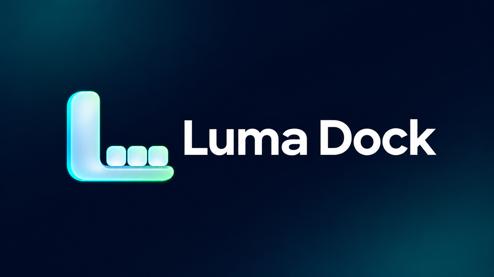
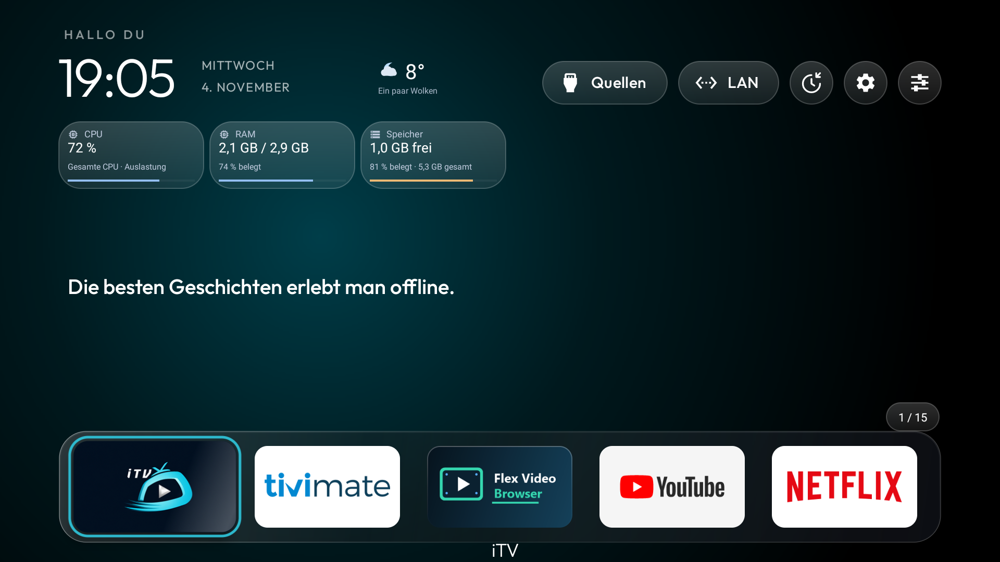
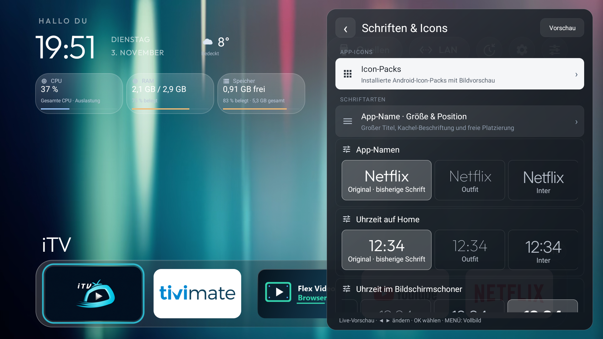
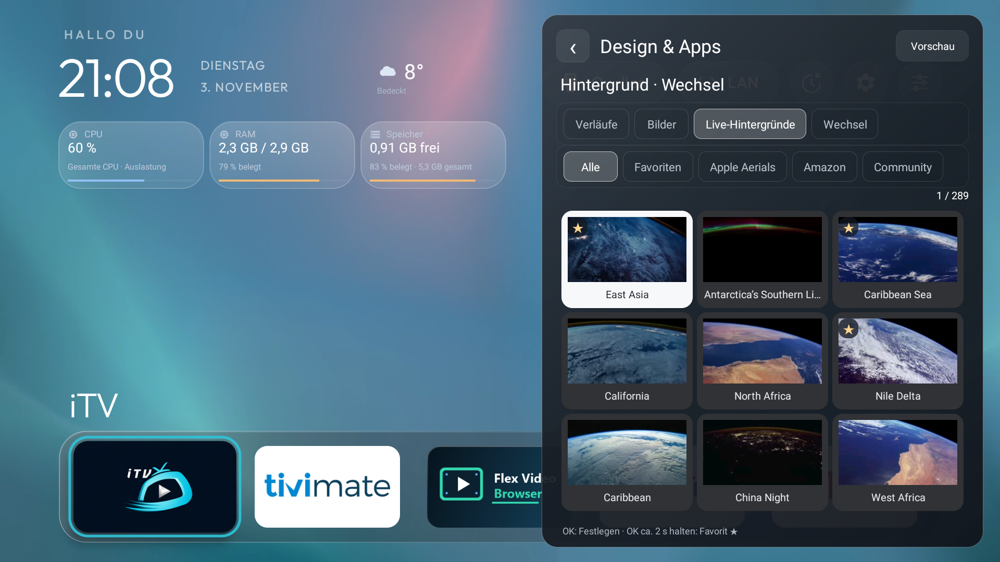
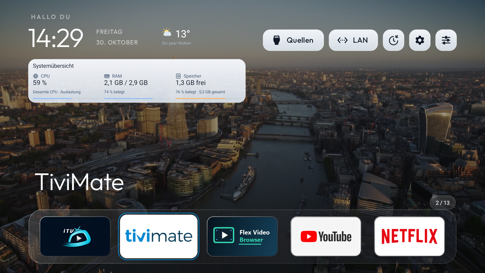
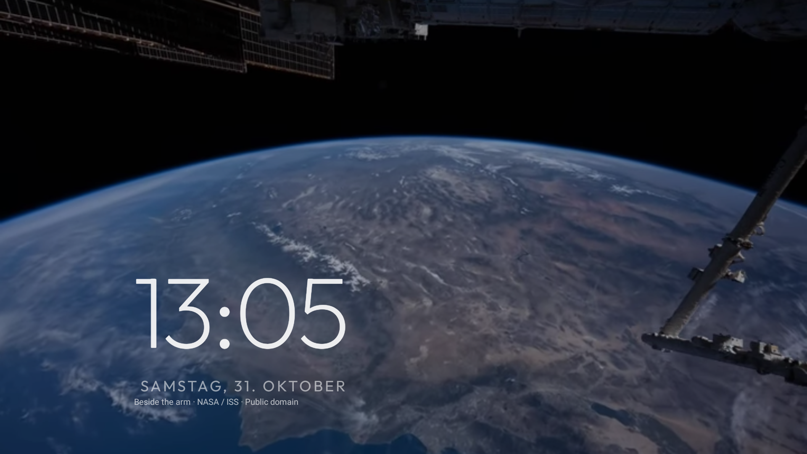

# Luma Dock

Ein anpassbarer, nativer Launcher für **Android TV und Google TV**: Glas-Dock, App-Sortierung, Live-Hintergründe, Widgets, Bildschirmschoner und Updates direkt über GitHub. Java, Android 8.0 / API 26 oder neuer.

## Einblicke

Echte TV-Screenshots mit unterschiedlichen Beispielkonfigurationen. Dock, Farben, Schriften, Widgets und Hintergründe lassen sich individuell einstellen.

**Startseite mit Glas-Dock, Wetter und Widgets**

| Design und Schriftvorschau | Live-Hintergründe und Favoriten |
| --- | --- |
|  |  |
| **Widgets und helles Theme** | **Bildschirmschoner** |
|  |  |

Die gezeigten App-Logos und externen Hintergrundinhalte gehören ihren jeweiligen Rechteinhabern; sie illustrieren die Darstellung im Launcher. Quellenhinweise stehen unter [Lizenzen und Herkunft](THIRD_PARTY_NOTICES.md).

## Funktionen

- Dock und Raster mit wählbaren Spalten, Paging/Pivot, Sortierung, App-Namen und Icon-Packs.
- Fokusrahmen, Abstand, Stärke, Glanz, Farbverläufe, Glow und Zoom getrennt anpassbar.
- Glas- und Farb-Themes für Dock, Buttons und Widgets; direkte Vorschau in der Einstellungen-Liste.
- Fotos, Verläufe und stumme Live-Hintergründe, Favoriten per langem OK und kombinierbare Wechselregeln.
- Frei platzierbare Uhr, Datum, Wetter und Systemanzeigen; eigene Widget-Quellen und Android-Widgets.
- Spruch-Widget als Text/Bild, Schriftvorschau und Pixel-Ein-/Ausflug mit Ebenen vor/hinter dem Dock.
- PIN-Schutz einzelner App-Starts im Launcher, Ausblenden und Verschieben per langem OK.
- Bildschirmschoner, Sleeptimer mit Countdown und optionale HDMI-CEC-Lautstärkeanzeige.
- **Info** mit Version, täglicher Update-Prüfung, optionalem Download und geprüftem Android-Installer.
